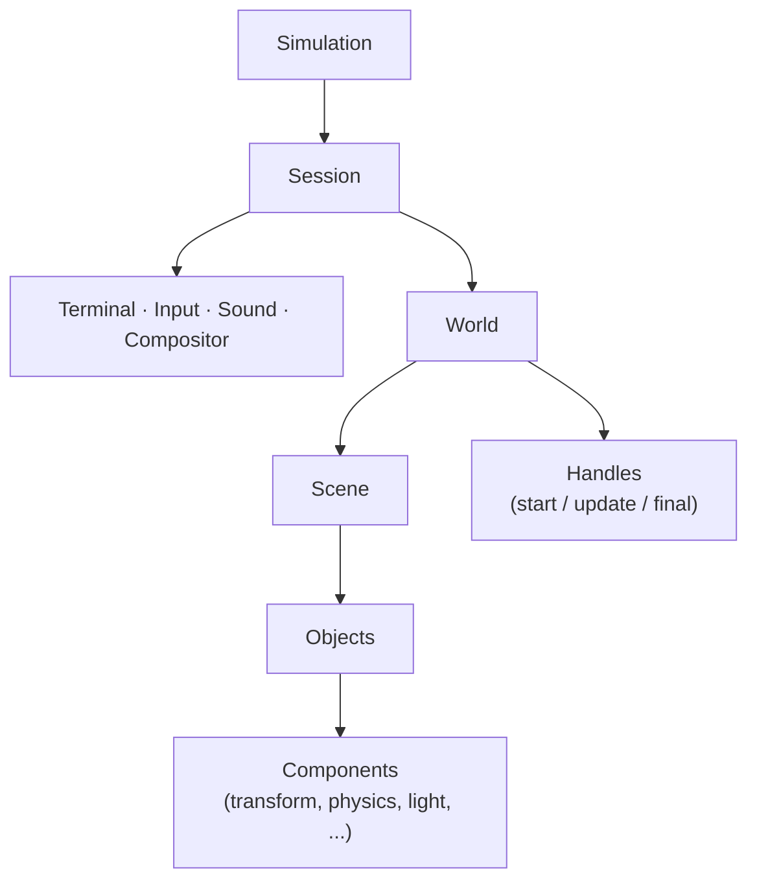

<a id="top"></a>

<div align="center">

# TTY Engine

**A terminal rendering, physics and sound engine for Python.**

Build animated, interactive scenes out of text, with collisions, joints, lighting, FIGlet fonts, images and audio, using nothing but the standard library.

[](#requirements)
[](#requirements)
[](LICENSE)
[](#requirements)
[](https://github.com/asard6348/tty-engine/commits)
[](https://pypi.org/project/ttyengine/)

[Installation](#installation) ·
[Quick start](#quick-start) ·
[How it works](#how-it-works) ·
[Usage guide](#usage-guide) ·
[Examples](#examples) ·
[Configuration](#configuration) ·
[Requirements](#requirements) ·
[License](#license)

</div>

---

TTY Engine draws everything as styled text and updates the terminal once per frame. Objects are assembled from small components, which are attached automatically based on the keyword arguments you pass when creating them. A box of text becomes a physics body as soon as you give it a velocity, and a light source as soon as you give it a light.

- **No dependencies.** Image decoding (PNG, JPEG, GIF, BMP, PNM; many more when ffmpeg is installed), FIGlet text, the audio mixer and the terminal and input handling are all implemented in the standard library.
- **Component-based objects.** `transform`, `rendering`, `physics`, `pen`, `force`, `joint` and `light` cover position and style, collisions, drawing, area forces, linked bodies and lighting.
- **Rich text output.** Truecolor, transparency and fades, bundled FIGlet fonts, and image-to-text conversion.
- **Input and sound included.** Keyboard and mouse input with press, release and held states, plus a built-in mixer with a small synthesizer.
- **Simple structure.** Write a class (or just a function) with `start`, `update` and `final` methods, and hand it to `start()`.

<!--
Previews section is disabled until the recordings are ready.
To enable it, remove this comment's opening and closing markers and restore the '[Previews](#previews) ·' link in the navigation above.
Replace the placeholders below with your own recordings.
Suggested layout: put the files in docs/previews/ and keep each one around 600-800 px wide.
If a preview needs a longer caption, add it in the cell under the image.

## Previews

<table>
  <tr>
    <td align="center" width="50%">
      <br>
      <sub><b>Overview</b><br>Short description of this preview.</sub>
    </td>
    <td align="center" width="50%">
      <br>
      <sub><b>Physics and joints</b><br>Short description of this preview.</sub>
    </td>
  </tr>
  <tr>
    <td align="center" width="50%">
      <br>
      <sub><b>Lighting</b><br>Short description of this preview.</sub>
    </td>
    <td align="center" width="50%">
      <br>
      <sub><b>Text, FIGlet and images</b><br>Short description of this preview.</sub>
    </td>
  </tr>
</table>

<sub>[↑ Back to top](#top)</sub>
-->

## Installation

<details open>
<summary><b>Install from PyPI</b></summary>

&nbsp;

```sh
pip install ttyengine
```

To get the latest unreleased changes, install straight from the repository:

```sh
pip install git+https://github.com/asard6348/tty-engine
```

To work on the engine itself, clone it and install in editable mode:

```sh
git clone https://github.com/asard6348/tty-engine
cd tty-engine
pip install -e .
```

</details>

<details>
<summary><b>Optional extras</b></summary>

&nbsp;

| Extra | Command | What it adds |
|---|---|---|
| `keyboard` | `pip install "ttyengine[keyboard]"` | Low-level key press and release tracking, which is what makes `inp.held()` accurate. It needs root on Linux and macOS. |
| `ffmpeg` | `pip install "ttyengine[ffmpeg]"` | A bundled ffmpeg for decoding compressed audio formats and image formats beyond PNG, JPEG, GIF, BMP and PNM (WebP, TIFF, TGA, AVIF, ...). An ffmpeg already on your `PATH` works too. |

Without the `keyboard` package the engine falls back to terminal input. See [Input](#usage-guide) in the usage guide for what that changes.

</details>

<sub>[↑ Back to top](#top)</sub>

## Quick start

<details open>
<summary><b>Hello, terminal</b></summary>

&nbsp;

```python
from ttyengine import start

class main:
    def start(self, scene, session):
        scene.obj().create('hello, tty', 5, -3)

        def quit():
            session.running = False
        session.inp.onpress('x', quit)

start(main)
```

Run it, and press `x` to exit. The text appears five columns from the left and three rows from the top, because `y` counts upward and the top of the screen is `0` (see [Coordinates](#how-it-works)).

`start(*launch, **settings)` creates a `Session`, creates a `World` holding every handle you pass in, runs the session with your settings and returns a `Simulation`.

</details>

<details>
<summary><b>A function works too</b></summary>

&nbsp;

A launched handle can be a plain function. It is treated as the handle's `start` method:

```python
from ttyengine import start

def main(scene, session):
    scene.obj().create('just a function', 2, -2)

start(main)
```

</details>

<sub>[↑ Back to top](#top)</sub>

## How it works

<details>
<summary><b>Structure: simulation, session, world, scene</b></summary>

&nbsp;



| Layer | Role |
|---|---|
| **Simulation** | The top-level container returned by `start()`. It exposes `sessions`, `worlds`, `handles` and `scenes`, and has `session()`, `world()`, `launch()`, `run()` and `stop()` for building more. |
| **Session** | Owns the terminal. It provides input (`session.inp`), sound (`session.sound`) and styling helpers (`session.style`, `session.styler`), and runs the main loop until `session.stop()` is called or `session.running` is set to `False`. |
| **World** | A scene together with the handles that drive it. A session can hold several worlds, which are composited into a single frame. |
| **Scene** | The simulated space: objects, gravity, camera, lights and the background color. |
| **Handle** | Your code. A class (or function) whose `start`, `update` and `final` methods are called by the world. |
| **Object** | A bag of components. Created with `scene.obj().create(...)`. |

</details>

<details>
<summary><b>The frame loop</b></summary>

&nbsp;

Every frame, each active world goes through the same steps:

1. **`update`** is called on every handle, highest `priority` first.
2. **`scene.tick()`** advances the simulation: physics, fades, joints and lights.
3. **`final`** is called on every handle, after the physics has settled.
4. The scene's pending changes are flushed and the **compositor** builds the frame, which is written to the terminal in a single synchronized update.

Use `update` for input and decisions, and `final` for anything that should react to where physics left things, such as a camera that follows an object.

The frame rate is controlled per scene through `scene.framerate` (60 by default, capped by `scene.maxframerate`). Physics advances one step per tick, so velocities are measured in cells per tick.

</details>

<details>
<summary><b>Coordinates</b></summary>

&nbsp;

- The origin `(0, 0)` is the **top-left** corner of the view.
- `x` grows to the **right**.
- `y` grows **upward**, so anything visible on screen below the origin has a negative `y`.
- The camera (`scene.camx`, `scene.camy`) is the world position of the top-left corner of the view.

```python
scene.obj().create('top-left corner', 0, 0)
scene.obj().create('three rows down', 0, -3)
```

Mouse positions are reported in terminal cells counted from the top-left. With the camera at its default position, a mouse cell `(x, y)` corresponds to the world position `(x, -y)`.

</details>

<details>
<summary><b>Objects and components</b></summary>

&nbsp;

An object starts out empty. `create()` looks at its keyword arguments, attaches the components that own them, and passes each value on. `transform` and `rendering` are always attached; the others are added the first time you use one of their settings.

| Component | Added when you pass | What it does |
|---|---|---|
| `transform` | always | Position, text, colors, opacity, rotation, flipping, shadow. |
| `rendering` | always | Visibility (`show`), drawing order (`z`) and whether spaces are drawn (`spaces`). |
| `physics` | `xvel`, `yvel`, `bounciness`, `gravity`, `friction`, `mass`, `phantom`, ... | Velocity, collisions, bouncing, friction and touch callbacks. |
| `pen` | `pen={...}` | Paints characters at a point relative to the object. Settings: `char`, `x`, `y`, `radius`, `shape`. |
| `force` | `force=...` or `force={...}` | Pushes other objects, optionally limited by a radius or a filter. Settings: `strength`, `affect`, `cap`, `position`, `radius`, `torque`, `shield`. |
| `joint` | `preset`, `joints`, `elasticity`, `kind`, ... | Links objects together as a rope, rod, spring, hinge, slider or fixed joint. |
| `light` | `light=True` or `light={...}` | Turns the object into a light source. Settings: `color`, `alpha`, `radius`, `falloff`, `shadows`, `cone`, `direction`, `glow` and more. `scene.ambient` sets the base brightness. |

Settings can be given flat, or grouped under the component's name. The two calls below are equivalent:

```python
scene.obj().create('x', 3, -4, bounciness=0.5, friction=0.1)
scene.obj().create('x', transform={'x': 3, 'y': -4},
                   physics={'bounciness': 0.5, 'friction': 0.1})
```

Some names are shared between components, such as `x`, `y` and `radius`, so `pen`, `force` and `light` are configured through their grouped form:

```python
scene.obj().create('*', 20, -6, light={'color': 'yellow', 'radius': 12})
scene.obj().create('@', 10, -6, force={'strength': 2, 'radius': 8})
scene.obj().create('+', 5, -2, pen={'char': '*', 'radius': 2})
```

</details>

<details>
<summary><b>Handles and their parameters</b></summary>

&nbsp;

A handle may define any of `start`, `update` and `final`. Each one receives only the arguments it asks for, matched by parameter name:

| Name | Value |
|---|---|
| `scene` | The world's scene. |
| `session` | The running session, which gives you `session.inp`, `session.sound` and `session.running`. |
| `world` | The world that owns the handle. |
| `handle` | The handle itself, which can be paused or cancelled. |
| `sound` | Shortcut for `session.sound`. |
| `simulation` | The `Simulation`, for creating more sessions and worlds. |

A world's `scene.termx`, `scene.termy`, `scene.dimx` and `scene.dimy` are filled in as soon as the world is created, using the terminal size and the session's region settings, so `start` and any code that runs before `session.run()` already sees the real values. They keep following the terminal while the session runs, unless `autoterm` or `autodim` is turned off.

```python
class main:
    priority = 5            # higher runs first within a frame (default 0)

    def start(self, scene):                 # once, when launched
        ...
    def update(self, scene, session):       # every frame, before physics
        ...
    def final(self, scene):                 # every frame, after physics
        ...
```

</details>

<sub>[↑ Back to top](#top)</sub>

## Usage guide

<details>
<summary><b>Creating, changing and removing objects</b></summary>

&nbsp;

```python
obj = scene.obj().create('hello', 10, -4, fg='cyan')

obj.transform.x += 1          # components are plain attributes
obj['x'] = 12                 # or read and write settings by name

copy = obj.clone(x=30)        # same settings, with overrides
obj.ondiscard(lambda: print('gone'))
obj.discard()                 # remove it from the scene
```

`obj.kwargs()` returns the settings that were set explicitly, which is what `clone()` uses.

</details>

<details>
<summary><b>Keyboard and mouse input</b></summary>

&nbsp;

Input lives on `session.inp`. Callbacks receive as many of their possible arguments as their signature accepts, so a callback can take none, some or all of them.

```python
inp = session.inp

inp.onpress('space', jump)                 # on key down
inp.onrelease('space', stop_jump)          # on key up
inp.onkey(None, log_key, event='press')    # every key; cb(key, event)
inp.onpress('x', quit, once=True)          # remove itself after firing
inp.onpress('a', go_left, caps=True)       # matches 'a' and 'A'

inp.held('left')                           # True while the key is down
inp.held(['left', 'a'])                    # True if any of them is down
inp.held()                                 # list of every key currently down

inp.onmouse('click', on_click)             # cb(x, y, data, event)
inp.onmouse('move', on_move)               # 'click', 'release', 'move', 'wheel' or 'any'
inp.mouse                                  # current mouse position
```

Key names include letters, digits, `up`, `down`, `left`, `right`, `space`, `esc`, `enter`, `tab`, `backspace` and `shift`.

Callbacks can be removed again with `offpress`, `offrelease`, `offkey`, `offmouse` and `stop_all`.

**How accurate `held()` is depends on the terminal.** The engine uses the best tier available:

1. The `keyboard` package, which reports real presses and releases.
2. The kitty keyboard protocol, in terminals that support it, which does the same.
3. Plain terminal input otherwise. Terminals do not send release events, so a key counts as held while it keeps repeating. Pass `delay=` to `held()` or `onrelease()` to control how long a key stays held after its last repeat.

</details>

<details>
<summary><b>Physics</b></summary>

&nbsp;

Giving an object any physics setting makes it a physics body. By default bodies are `dynamic` (they move) and `solid` (they block other solids).

```python
scene.gravity = (0, -1)                     # (x, y) acceleration for the whole scene

ball  = scene.obj().create('O', 10, 0, bounciness=0.8)
floor = scene.obj().create('#' * 40, 0, -10, dynamic=False)   # immovable
```

| Setting | Meaning |
|---|---|
| `xvel`, `yvel`, `avel` | Linear velocity in cells per tick, and angular velocity. |
| `dynamic` | `False` makes the object immovable, so it acts as a wall or floor. |
| `solid` | Whether other solid bodies are blocked by it. |
| `phantom` | Lets other bodies pass through, while still reporting overlaps. |
| `bounciness`, `friction` | Surface behavior on contact. |
| `mass` | Defaults to the number of visible characters. |
| `gravity` | An `(x, y)` pair that overrides the scene's gravity for this object. |
| `drag` | Overrides the scene's drag for this object. |

**Reacting to contact.** Two tools cover the two common cases:

```python
# Blocked by a solid: check the contact flags after the tick.
ball.physics.touch          # (touching_horizontally, touching_vertically)

# Overlapping something: ontouch fires while the objects overlap, which makes
# a phantom object a good trigger zone.
zone = scene.obj().create('[    ]', 20, -5, dynamic=False, phantom=True)

def entered(other):
    print('something is inside the zone')

player.physics.ontouch(entered)
```

`ontouch(callback, when=None, once=False)` accepts a `when(other)` filter and can be limited to a single call with `once=True`.

</details>

<details>
<summary><b>Camera</b></summary>

&nbsp;

```python
scene.camx = 40                       # move the view
scene.follow(hero)                    # center the view on an object
scene.follow(hero, smooth=8)          # ease toward it instead of snapping
scene.follow(hero, offset=(0, 3))     # keep the target slightly off-center
```

Call `follow()` from `final` so the camera sees the object's position after physics. `scene.camrotation` rotates the view.

</details>

<details>
<summary><b>Text, colors, fonts and images</b></summary>

&nbsp;

`session.style()` returns an ANSI-styled string that you can pass to `create()` like any other text. The engine reads the colors back out of it, so styled text keeps its layout.

```python
title = session.style('TTY', font='slant', color='cyan')
scene.obj().create(title, 2, -1)

session.style('warning', color='orange', bold=True)
session.style('tint', color=(255, 80, 120), bgcolor='darkblue')
```

- **Colors** can be a name (`'red'`, `'brightcyan'`, `'darkgreen'`, `'gray'`, ...) or an `(r, g, b)` tuple.
- **FIGlet fonts** are bundled. `session.styler.fonts()` lists them, and `font=` accepts any name from that list.
- **Shapes** are available through `session.styler.shapes`: `circle`, `ellipse`, `block`, `triangle`, `diamond` and `line`.
- **Images** are converted to text with `session.styler.image(path, width=..., height=...)`. PNG, JPEG, GIF, BMP and PNM are decoded by the engine itself, and other formats (WebP, TIFF, TGA, ...) are decoded through ffmpeg when it is available. If you give neither `width` nor `height`, the image is `80` columns wide (or its own pixel width, if that is smaller), so the result is the same on every terminal.

```python
ring = session.styler.shapes.circle(5)
scene.obj().create(ring, 10, -4)

photo = session.styler.image('logo.png', width=40)
scene.obj().create(photo, 0, -2)
```

Per-object appearance is set on the transform: `fg`, `bg`, `alpha`, `bgalpha`, `rotation`, `flip` and `shadow`.

</details>

<details>
<summary><b>Fades and smooth movement</b></summary>

&nbsp;

```python
obj.transform.fade(0, time=1)                          # fade out over one second
obj.transform.fade(0, time=1, discard=True)            # ...and remove it afterwards
obj.transform.fade(1, time=0.5, delay=0.2, ease='linear')

scene.fade((0, 0, 0), time=2)                          # fade the whole scene to black
```

`transform.lerp(weight, **targets)` moves any numeric setting a fraction of the way toward a target, which is handy for smoothing inside `update`:

```python
def update(self):
    self.hero.transform.lerp(0.2, x=self.target_x)
```

</details>

<details>
<summary><b>Sound</b></summary>

&nbsp;

Audio goes through `session.sound`, which every handle can also receive as the `sound` parameter. Files are decoded and cached on first use, and the engine can synthesize simple sounds without any audio files.

```python
sound.beep()                                       # short blip
sound.play(sound.tone(440, 0.5, wave='sine'))      # a sustained note
sound.play(sound.melody('C4 E4 G4:2', beat=0.25))  # note names, optional :beats

voice = sound.play('music.wav', loop=True, volume=0.6)
voice.pitch = 3                 # semitones
voice.pan = -0.5                # left
voice.stop(fade=1.0)
```

`play()` returns a `Voice`, which you can pause, resume, seek, fade and give an `oncomplete` callback. WAV files load without extra tools, and compressed formats need the `ffmpeg` extra. Pass `Session(sound=False)` to turn audio off entirely.

</details>

<details>
<summary><b>Several worlds and sessions</b></summary>

&nbsp;

Each world has its own scene and handles, and the session composites its worlds into one frame. This is useful for a HUD layered over a game, or a menu with its own camera.

```python
from ttyengine import Session

session = Session()
game = session.World()
hud  = session.World()

game.launch(game_handle)
hud.launch(hud_handle)

session.run()
```

The `Simulation` returned by `start()` exposes `sessions`, `worlds`, `handles` and `scenes`, and handles can reach it through their `simulation` parameter.

</details>

<sub>[↑ Back to top](#top)</sub>

## Examples

Every example below is a complete program. Press `x` or close the terminal to exit where an exit key is set.

<details open>
<summary><b>Move a character with the arrow keys</b></summary>

&nbsp;

```python
from ttyengine import start

class main:
    def start(self, scene, session):
        self.hero = scene.obj().create('@', 20, -8)
        session.inp.onpress('x', lambda: setattr(session, 'running', False))

    def update(self, session):
        held = session.inp.held
        t = self.hero.transform
        if held('left'):  t.x -= 1
        if held('right'): t.x += 1
        if held('up'):    t.y += 1
        if held('down'):  t.y -= 1

start(main)
```

</details>

<details>
<summary><b>A bouncing ball</b></summary>

&nbsp;

```python
from ttyengine import start

def main(scene, session):
    scene.gravity = (0, -1)
    scene.obj().create('O', 20, -1, bounciness=0.8)
    scene.obj().create('#' * 60, 0, -15, dynamic=False)
    session.inp.onpress('x', lambda: setattr(session, 'running', False))

start(main)
```

</details>

<details>
<summary><b>Text that follows the mouse</b></summary>

&nbsp;

The handler moves the object by the distance between its center and the mouse. Assigning an absolute position would not work here, because `center()` already includes the object's current position. Pass `local=True` to `center()` or `extent()` to get the values relative to the object's own position instead.

```python
from ttyengine import start

def main(scene, session):
    label = scene.obj().create('hi', 10, -5)

    def follow(x, y):
        t = label.transform
        cx, cy = t.center()
        t.x += x - cx
        t.y += -y - cy        # mouse rows count down, world y counts up

    session.inp.onmouse('move', follow)
    session.inp.onpress('x', lambda: setattr(session, 'running', False))

start(main)
```

</details>

<details>
<summary><b>A trigger zone with a sound</b></summary>

&nbsp;

```python
from ttyengine import start

class main:
    def start(self, scene, session, sound):
        self.player = scene.obj().create('@', 2, -8, xvel=0)
        zone = scene.obj().create('[ ]', 30, -8, dynamic=False, phantom=True)

        self.player.physics.ontouch(lambda other: sound.beep(660), once=False)
        session.inp.onpress('x', lambda: setattr(session, 'running', False))

    def update(self, session):
        held = session.inp.held
        self.player.physics.xvel = (1 if held('right') else 0) - (1 if held('left') else 0)

start(main)
```

</details>

<details>
<summary><b>A styled title that fades out</b></summary>

&nbsp;

```python
from ttyengine import start

def main(scene, session):
    title = scene.obj().create(
        session.style('TTY ENGINE', font='slant', color='cyan'), 4, -3)
    title.transform.fade(0, time=3, delay=1, discard=True)

start(main)
```

</details>

<details>
<summary><b>A camera that follows the player</b></summary>

&nbsp;

```python
from ttyengine import start

class main:
    def start(self, scene, session):
        self.hero = scene.obj().create('@', 0, -8)
        for i in range(0, 400, 20):
            scene.obj().create('|', i, -8)         # markers to show the scrolling
        session.inp.onpress('x', lambda: setattr(session, 'running', False))

    def update(self, session):
        held = session.inp.held
        self.hero.transform.x += (1 if held('right') else 0) - (1 if held('left') else 0)

    def final(self, scene):
        scene.follow(self.hero, smooth=6)

start(main)
```

</details>

<sub>[↑ Back to top](#top)</sub>

## Configuration

<details>
<summary><b>Session settings</b></summary>

&nbsp;

Settings are passed to `start()`, `Session()` or `run()`, and are stored as attributes on the session, so many of them can also be changed while it is running.

| Setting | Default | Meaning |
|---|---|---|
| `mouse` | `True` | Report mouse clicks, drags and motion. |
| `vsync` | `True` | Present each frame as one synchronized update (terminals such as kitty then paint it all at once instead of progressively) and in step with the display's refresh. On Windows the compositor waits for the desktop compositor's vertical blank; on other systems it locks presentation to the detected refresh rate with a fixed-phase clock, since a terminal has no direct access to the display. |
| `refresh` | `None` | Display refresh rate in Hz (24 to 1000) used by `vsync`. `None` detects it, falling back to 60. The `TTYENGINE_REFRESH` environment variable overrides detection. Setting it also makes Windows use the timer instead of the desktop compositor. |
| `fullscreen` | auto | Use the alternate screen. By default this is chosen from whether the engine draws in the whole terminal or only a region. |
| `hidecursor` | auto | Hide the text cursor while running. |
| `no_color` | `None` | `True` strips color codes from all output. Any value other than `None` overrides the `NO_COLOR` environment variable. |
| `optimize` | `True` | Switch the terminal into the modes the engine needs (raw input, hidden cursor, no line wrapping, synchronized output). |
| `pausephysics` | `False` | Stop physics for every world. |
| `pauserendering` | `False` | Stop drawing for every world. |
| `termxoffset`, `termyoffset` | `0` | Top-left corner of the part of the terminal the engine draws in. |
| `termwidth`, `termheight` | `None` | Size of that region. `None` uses the rest of the terminal. |
| `autoterm` | `True` | Keep each scene's terminal size in sync with the region. The size is applied when a world is created and again every frame. |
| `autodim` | `True` | Keep each scene's dimensions in sync with its terminal size. They are applied when a world is created and again every frame. |
| `autobg` | `True` | Fill the background automatically. |
| `outerbg` | `True` | Fill the area outside the region with the background color. |
| `autofps` | `True` | Tie each scene's maximum frame rate to the measured terminal latency. |
| `clearonstop` | `True` | Clear the screen when the session stops. |

Constructor-only options on `Session()`:

| Option | Meaning |
|---|---|
| `inp=False` | Disable the input system (`session.inp` becomes `None`). |
| `sound=False` | Disable audio (`session.sound` becomes `None`). |
| `style=False` | Disable the styling layer. |
| `watchfocus`, `trackmotion` | Control whether terminal focus changes and mouse motion are tracked. |
| `ffmpeg` | Path to an ffmpeg executable for audio and image decoding. It applies even with `sound=False`. |

</details>

<details>
<summary><b>Manual setup</b></summary>

&nbsp;

Build the objects yourself when you need `Session` options such as `sound=False`, or several sessions and worlds:

```python
from ttyengine import Session

session = Session(sound=False)
world = session.World()
world.launch(main)
session.run()
```

</details>

<details>
<summary><b>Error reporting</b></summary>

&nbsp;

An uncaught error inside the engine (a handle, a callback or the main loop) restores the terminal, prints the traceback to `stderr` and exits with code 1. Colors and screen clearing are used only when `stderr` is a terminal, so redirected output stays plain.

On Windows, a console opened by double-clicking a script closes as soon as the script exits, which hides the traceback. The engine then waits for Enter before exiting. This is detected automatically, and you can override it with the `TTYENGINE_HOLD` environment variable (`auto`, `always` or `never`).

The same reporting is available for code outside the engine:

```python
from ttyengine import errors

errors.install()

errors.attempt(risky, fatal=False)
```

`errors.install()` replaces `sys.excepthook` so any uncaught exception is printed and, where needed, held open. `errors.attempt(func, fatal=False)` reports an exception and returns `None` instead of exiting. Both accept `hold=True`, `hold=False` or `hold='auto'`, and `attempt` also accepts a `code` for the exit status.

</details>

<details>
<summary><b>Colors and ANSI wrapping</b></summary>

&nbsp;

Set the `NO_COLOR` environment variable to any non-empty value to strip color codes from everything the engine writes. Attributes such as bold are kept. `start(no_color=True)`, `Session(no_color=True)` and `Compositor(no_color=True)` do the same per instance, and any value other than `None` overrides the environment.

Every ANSI code can be surrounded by a prefix and a suffix, both when the engine writes it and when it reads it from your text. Set them with the `TTYENGINE_ANSI_PREFIX` and `TTYENGINE_ANSI_SUFFIX` environment variables (backslash escapes such as `\001` are decoded) or in code:

```python
from ttyengine import ansi

ansi.set_wrapper(prefix='\x01', suffix='\x02')
```

A value of `None` falls back to its environment variable, and both are empty by default.

</details>

<sub>[↑ Back to top](#top)</sub>

## Requirements

- **Python 3.8 or newer.**
- **Windows, macOS or Linux**, in a terminal that supports ANSI escape sequences. Truecolor and the kitty keyboard protocol are used when the terminal offers them.
- **No required packages.** The optional [`keyboard` and `ffmpeg` extras](#installation) add accurate key tracking, compressed-audio decoding and more image formats.
- The project is in **alpha**, so APIs may still change.

<sub>[↑ Back to top](#top)</sub>

## License

TTY Engine is licensed under the [Mozilla Public License 2.0](LICENSE). Bundled FIGlet fonts and code are covered by `ttyengine/figlet-LICENSE.txt`.

<sub>[↑ Back to top](#top)</sub>
